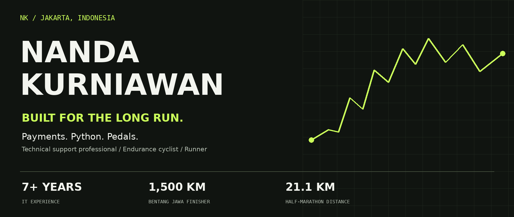

  

  <strong>ROAD · GRAVEL · ULTRA-ENDURANCE · RUNNING</strong> 
  Based in Jakarta, Indonesia. Always looking for the next road, trail, and story.

  <a href="https://www.instagram.com/nand4k/">Instagram / @nand4k</a> ·
  <a href="https://dirtyland.cc">DIRTYLAND</a> ·
  <a href="#lets-make-something-happen">Collaborate with me</a>

## A little further, every time.

I'm **Nanda Kurniawan**, an endurance cyclist and runner from Jakarta. I started cycling in May 2024. A little over a year later, I crossed Java on my bike and finished **Bentang Jawa—approximately 1,500 km of unsupported riding**.

What keeps me going is everything around the distance: early starts with friends, unfamiliar roads, the climb that takes longer than expected, and the stories you bring home. These days, that means road cycling, gravel, and learning to go further on foot, too.

Away from sport, I work in IT at **DANA Indonesia**. I also build things for the cycling community, including the **Dirtyland website**.

## Brands I've worked with

  

I've had the opportunity to work with **Pirelli, Castelli, Spectrum Optics, and Cervélo** along my cycling journey.

For future collaborations, I'm interested in taking products into the rides I actually do—and sharing the experience honestly, from everyday training to longer adventures.

## Across Java. Under my own power.

### BENTANG JAWA 2025 / FINISHER

| Distance | Climbing | Result |
| :--- | :--- | :--- |
| **≈1,500 km** | **≈16,000 m** | **59th · Solo Men** |

An unsupported journey across Java, from Carita to Banyuwangi. Managing the route, the effort, the food, and the rest was all part of getting to the finish.

This is my biggest cycling milestone so far—and a reminder of how much can change when you keep showing up.

### More days out on the bike

- **Banten Loop:** approximately **530 km** across two days.
- **Jakarta–Bandung–Jakarta:** repeated rides of around **300 km**, with long climbs and plenty of time on the road.
- **Dirtyland Sessions:** **125 km** of gravel riding.
- **January–May 2026:** approximately **5,500 km** ridden.
- Between the longer adventures: community rides, morning training, and exploring on both road and gravel bikes.

## The progression

| Chapter | What changed |
| :--- | :--- |
| **May 2024 / Start riding** | Built a regular riding habit and began exploring longer distances. |
| **2024–2025 / Go longer** | Moved into audax, 300 km rides, and the approximately 530 km Banten Loop. |
| **2025 / Cross Java** | Finished Bentang Jawa, approximately 1,500 km, placing 59th in Solo Men. |
| **2026 / Explore more** | Kept building road mileage, added more gravel, and started running. |

### Running: starting again, in a different sport

I started running in **May 2026**. Having a cycling background gave me a love for endurance, but running brought a new learning curve.

| Milestone | Personal training progress |
| :--- | :--- |
| **The beginning** | Early 5 km runs at around **8:55/km**. |
| **By August 2026** | Completed the **half-marathon distance twice**, at roughly **7:00–7:30/km**. |
| **Building speed** | A **10 km effort around 5:00/km**. |
| **Looking ahead** | Build consistency and endurance toward a **first marathon**. |

Distances and paces are approximate personal training milestones, not certified race PBs.

## Next on the horizon

### 01 / Bentang Jawa KELANA Vol. 4
**Target event · 8 November 2026 · Pekalongan, Central Java**

**167 km / 3,600 m of climbing** across the **North Serayu Mountains**. An unsupported, self-navigated event combining paved roads, gravel, and trails.

[Explore the event →](https://bentangjawa.cc/bentang-jawa-kelana-vol-4/)

### 02 / DIRTYLAND XL
**Planned gravel event · Approximately 350 km**

**December 2026 / January 2027 — TBC.** The next long gravel adventure on my radar.

## Part of the cycling world, on and off the bike

### DIRTYLAND / Website project

I build and maintain **[dirtyland.cc](https://dirtyland.cc)**, bringing my technical background into a sport I love.

My work covers event information, individual and collective registration, route and GPX visibility, schedules, sponsor sections, participant exports, and films. It's a way to contribute beyond riding: helping people find the information they need and connect with the event.

## Let's make something happen

I'm open to **brand collaborations, product support, event projects, and stories built around cycling and running**.

What I can bring:

- **Real riding experience:** road, gravel, and unsupported long-distance efforts.
- **Stories from the process:** preparation, training, event days, and what happens between the start and finish.
- **Practical product feedback:** observations from equipment used on actual rides.
- **Community involvement:** local rides, cycling events, and the digital side of Dirtyland.

**[Message me on Instagram / @nand4k →](https://www.instagram.com/nand4k/)**

---

### The other side of me / IT & payments

**Technical Support at DANA Indonesia · March 2022–present · 7+ years in IT**

I troubleshoot payment issues, investigate transactions, and build reporting automations. My toolkit includes **Python, SQL, Linux, Bash, Kibana, Grafana, Jenkins, and Git**. I hold a degree in **Information Systems from the University of Riau**.

Alongside sport, I'm open to **Technical Support, Application Support, and Technical Operations** roles—remote opportunities hiring in Indonesia, or relocation with visa sponsorship in Europe and APAC.

  <strong>More roads. More trails. More stories.</strong> 
  Nanda Kurniawan / @nand4k · Updated October 2026

